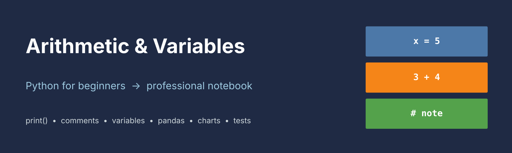
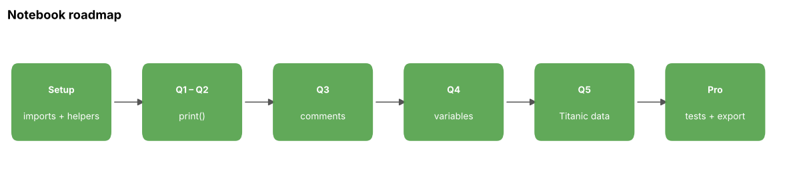
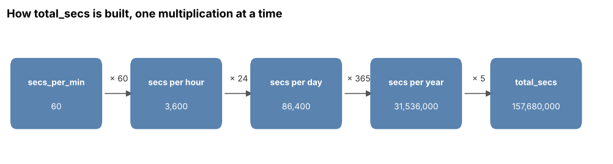
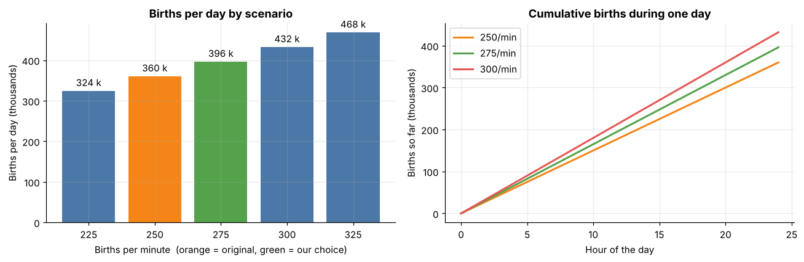
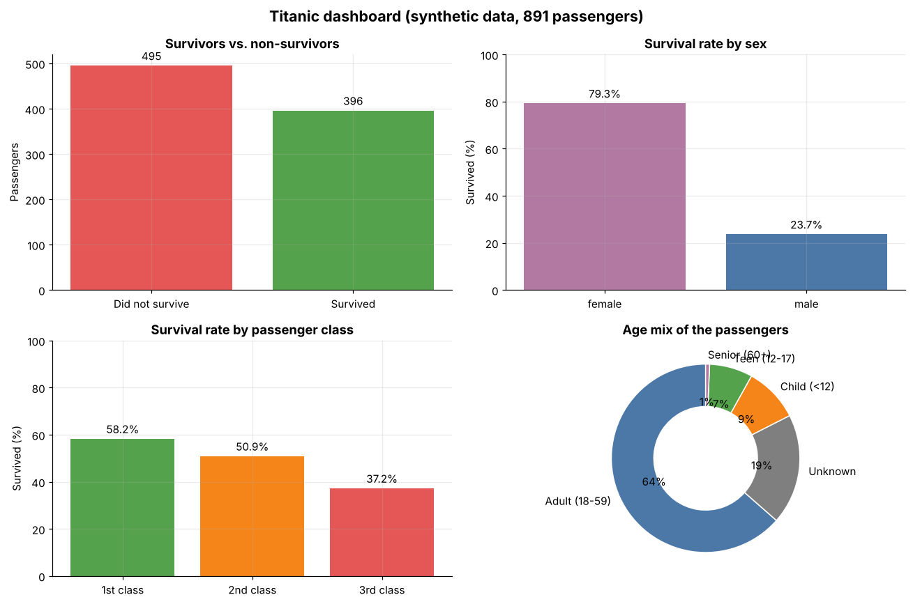

<p align="center"></p>

# 🐍 Arithmetic & Variables in Python — Professional Edition


A self-contained, beginner-to-professional Jupyter notebook that upgrades the Kaggle *Intro to Programming → Arithmetic and Variables* exercise. No Kaggle account, `learntools` or external data needed.

**Author:** Harpreet Singh

## ✨ Highlights

- 🧪 **Self-contained**: a reproducible Titanic-style dataset (891 rows, fixed seed `2026`)
- 🔢 **Varied values**: 5 years instead of 4, 275 births/min instead of 250, compared with the originals
- 📊 **Charts**: line, bar, stacked histogram, donut, box plot, scatter, heat maps
- 🗂️ **Tables** and 🧭 **flow diagrams** that show how each calculation is built
- ✅ **Pro features**: type hints, data class, input validation, 14 self-checks, CSV/JSON export, reproducibility report

## 🧭 Notebook roadmap



| Question | Topic | Key result |
| --- | --- | --- |
| 1 | `print()` | `Hello, world!` |
| 2 | Text vs arithmetic | `"3+4"` prints text, `3 + 4` prints 7 |
| 3 | Comments with `#` | commented code does not run |
| 4 | Variables | 5 years = 157,680,000 s |
| 5 | Fractions with pandas | `survived / total` |

## 🖼️ Previews

**Variables make calculations readable**



**Original vs new values**



**Fractions on the Titanic-style table**



> ⚠️ The Titanic table is **synthetic** (generated), not the real passenger list. The preview chart above is illustrative; run the notebook for exact numbers.

## 🚀 Quick start

```bash
git clone https://github.com/harpreetsingh171190-cmyk/arithmetic-and-variables-python.git
cd arithmetic-and-variables-python
pip install numpy pandas matplotlib jupyter
jupyter notebook arithmetic-and-variables-professional.ipynb
```

Or open the notebook in Google Colab and press **Runtime → Run all**.

## 📁 Structure

```
arithmetic-and-variables-python/
├── arithmetic-and-variables-professional.ipynb
├── images/
│   ├── banner.png
│   ├── roadmap.png
│   ├── variables-flow.png
│   ├── births-comparison.png
│   └── survival-by-class.png
└── README.md
```

## 🙏 Credits

Original exercise: [Intro to Programming](https://www.kaggle.com/learn/intro-to-programming) by Kaggle. Upgraded edition by **Harpreet Singh**.
